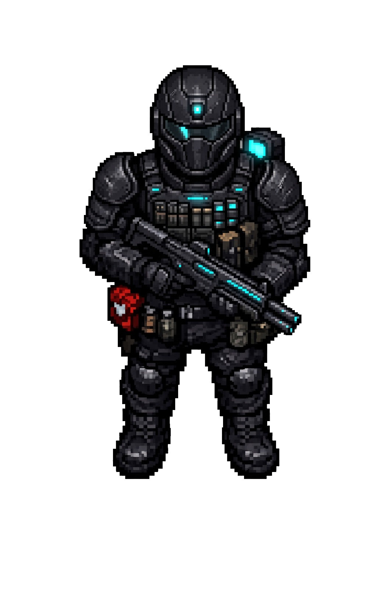

# ZİFİR — Kestrel Protokolü

**Karanlık anomali bölgelerine dal, yağmala, canlı çık. Ölürsen her şeyini kaybedersin.**
*Dive into dark anomaly zones, loot, extract alive. Die and lose it all.*

**[▶ Tarayıcıda oyna / Play in browser](https://owxmaybe.github.io/zifir/)** · [Kapak / Cover](https://owxmaybe.github.io/zifir/cover.html)

ZİFİR, tarayıcıda kurulum gerektirmeden çalışan, top-down bir **extraction aksiyon-RPG**'dir.
S.T.A.L.K.E.R. atmosferini, extraction türünün risk/ödül gerilimini ve hızlı, akıcı bir dövüş
hissini karanlık bir pixel-art dünyasında bir araya getirir. Oyun tek bir HTML5 dosyasıdır (Canvas 2D,
saf JavaScript, harici bağımlılık yok). Unity 6 ile mobil öncelikli bir remake'i de bu repoda.



---

## Hikâye

**2094.** Eclipse Olayı gerçekliği yırttı ve dünyanın kalbinde bir yara bıraktı: **The Zone**.
Sen dağılmış *Eclipse Protocol Unit*'in son operatörüsün. Her gece Zone'a giriyorsun: ganimet
topla, kayıp araştırmaları bul, çekirdeğe bir adım daha yaklaş ve **canlı çık**. Ölürsen
sırtındaki her şey Zone'un olur. Kaybettiklerin gezici bir yaratığa, *The Collector*'a geçer ve
sonraki raid'de peşine düşer.

## Öne çıkanlar

- **6 operatör**: her birinin kendine özgü yeteneği, pasifi ve oynanış kimliği var. Elmasla açılır.
- **7 silah**: deterministik, öğrenilebilir geri tepme (recoil) paternleri.
- **Extraction döngüsü**: gir, yağmala, canlı çık. Ölürsen kaybedersin.
- **Prosedürel sektörler**: Askerî Üs, Kimya Tesisi, Çöl Harabeleri, Buzul Üssü. Ana yollar, çok odalı temalı binalar ve anomali sahaları içerir.
- **Derin ilerleme**: seviye ve elmas, üs yükseltmeleri, silah ustalığı, loot perkleri.
- **Yaşayan tehlike**: sese tepki veren düşman yapay zekâsı, dinamik olaylar (fırtına, blackout, avcı timi), boss **THE SOURCE** ve gezici **THE COLLECTOR**.
- **Bölge tehlikeleri**: alarm kuleleri, zehir gölcükleri, sis, kar ve asit yağmuru.
- **EPU terminalleri**: frekans tarama, sinyal eşleme ve komut enjeksiyonu mini oyunları.
- **Erişilebilirlik**: 3 zorluk modu, ses, ekran sarsıntısı ve flaş ayarları, hasar sayıları, CRT filtresi.
- **Günlük Zone**: herkes için aynı seed ve skor paylaşımı.
- **Türkçe ve İngilizce**: menüden `L` ile anında dil değişimi.
- **Mobil**: dokunmatik joystick ve titreşim (haptics) desteği.

## Kontroller

| Tuş | Eylem |
|---|---|
| `W A S D` | Hareket |
| Fare | Nişan |
| Sol tık / Sağ tık | Ateş / Nişan alma (ADS) |
| `Space` | Dodge |
| `Shift` | Koşu |
| `E` | Operatör yeteneği |
| `F` | Etkileşim |
| `H` | Medkit |
| `R` | Şarjör doldurma |
| `1`–`8` / tekerlek | Silah seçimi |
| `P` | Duraklat |
| `L` | Dil (TR / EN) |

## Repo yapısı

| Yol | İçerik |
|---|---|
| `index.html` | Oyunun güncel sürümü. Tek dosya, doğrudan tarayıcıda açılır. |
| `versions/zifir-v1.html` | Önceki sürüm (arşiv) |
| `cover.html` | Kapak / tanıtım görseli |
| `unity/` | **Unity 6 remake** (URP 2D, mobil öncelikli). Mimari ve yol haritası için [`unity/ROADMAP.md`](unity/ROADMAP.md) |
| `docs/GDD.md` | *Project Eclipse: Lost Zone* ana oyun tasarım dokümanı (5 bölüm) |
| `docs/ITCH_SAYFASI.md` | itch.io yayın paketi (TR/EN mağaza metinleri) |
| `docs/PLAYSTORE_REHBERI.md` | HTML sürümünü Android'e (Capacitor) paketleme ve Play Store rehberi |
| `assets/` | Karakter çizimleri ve 3D karakter modeli (`.glb`) |

## Çalıştırma

**HTML5 sürümü:** `index.html` dosyasını herhangi bir modern tarayıcıda açman yeterli. Telefonda
aynı ağdan denemek için:

```bash
python -m http.server 8420
```

**Unity remake:** `unity/` klasörünü Unity Hub'dan **Unity 6** ile aç. Proje URP 2D ve yeni Input
System kullanıyor. Sahne ve arayüz koddan kuruluyor (`GameBootstrap`).

### Unity mimarisi kısaca

- 3 assembly: `Zifir.Core` (bağımlılıksız), `Zifir.Game` ve `Zifir.Editor`
- ScriptableObject tabanlı veri (`WeaponDef`, `OperatorDef`)
- Statik olay merkezi (`GameEvents`): sistemler birbirine doğrudan referans tutmaz
- Object pooling (mermi, efekt ve düşmanlar için; hedef sıfır GC spike)
- Sürümlü JSON kayıt sistemi ve anahtar tabanlı yerelleştirme (`Loc.T("menu.start")`)

## Teknolojiler

`HTML5 Canvas` · `JavaScript (ES2020)` · `Web Audio` · `Unity 6` · `C#` · `URP 2D` · `Input System`

---

**Geliştirici:** Eren Tyto ([@OwXMaybe](https://github.com/OwXMaybe)) · © 2026 Tüm hakları saklıdır.
